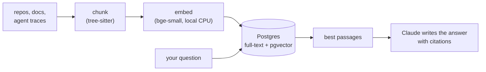

<div align="center">

# lore

**Ask your codebase a question. Get an answer with citations, in seconds.**

lore indexes your repos, docs and agent sessions once,<br>so every question starts from the right code instead of a blank grep.

[](https://github.com/sudopower/lore/actions/workflows/ci.yml)
[](LICENSE)


</div>

## At a glance

The same questions about a private 1,816-file service, asked of lore and of Claude Code exploring the repo on disk. Same model (`claude-opus-5-5`), same code.

| Question | lore fast | lore deep | Claude Code |
|---|---|---|---|
| "What's included in our entry-level billing plan?" | **4.9 s** | **13.3 s** | 28.0 s |
| "How does auth work in our control plane?" | **7.0 s** | 28.1 s | 22.3 s |

More questions, scores and setup: [benchmarks](docs/benchmarks.md).

## See it

```text
$ lore repo push . --name lore              # index lore's own repo
indexed lore at f8cd4b5: 105 indexed, 0 unchanged, 0 deleted, 2 skipped, 1523 chunks

$ lore ask "how are search results ranked?" --source lore --kind code

Search results come from a hybrid search. Postgres full-text ranking, which is
good at exact names, is fused with pgvector similarity, which is good at meaning,
using Reciprocal Rank Fusion [9].

- Two branches: a lexical branch and a vector branch each produce a ranked
  list of chunk ids for the query [5].
- Fusion score: an id earns 1 / (60 + rank) for each list it appears in [1].
  ...

Sources:
[9] src/search.rs:1-18
[5] src/search.rs:150-214
[1] src/search.rs:322-356
...
claude-opus-5-5 · 5262 ms
```

## Why lore

An agent working in a repo on disk finds code the slow way: grep, read a file, grep again, with a model round trip at every step. lore does that work once, when you index. A question then costs a 20 ms search and a single model call.

On real repos that means answers in **5 to 8 seconds**, 3 to 7 times sooner than Claude Code exploring the same repo. When you need the full picture, **deep** mode explores with tools and matched Claude Code on every question we scored.

## Two ways to ask

| | fast | deep |
|---|---|---|
| **How** | One search, one model call | Claude explores with `search`, `grep`, `read_file` and `get_session` |
| **Typical time** | 5 to 8 s | 15 to 30 s |
| **Best for** | "What is X?", "Where is Y?", standups | "How does X work?", tracing a code path |

## How it works



Code is split into functions and classes, embedded on your machine, and stored in Postgres. A question runs a keyword search and a meaning search together and merges the results. Claude only ever sees the passages lore picked, never the whole repo. The full tour is in [how lore works](docs/architecture.md).

## Quick start

You need Rust 1.95, Docker and an Anthropic API key.

```bash
git clone https://github.com/sudopower/lore && cd lore
make db-up                                   # Postgres with pgvector, in Docker
cargo install --path .                       # the lore CLI and server

export ANTHROPIC_API_KEY=sk-ant-... LORE_ADMIN_TOKEN=dev-admin
lore serve                                   # http://localhost:8080
```

In a second terminal, create a key, index a repo and ask:

```bash
export LORE_URL=http://localhost:8080 LORE_ADMIN_TOKEN=dev-admin
TENANT=$(lore admin tenant create --name me | jq -r .id)
export LORE_KEY=$(lore admin key create --tenant "$TENANT" | jq -r .key)

lore repo push ~/code/app
lore ask "how does auth work?"
lore ask "trace a request from the API to the database" --mode deep
```

The first start downloads the embedding model (about 130 MB). After that, search runs entirely on your machine.

## Use it from anywhere

- **The CLI:** `lore ask`, `lore search`, `lore repo push`.
- **The web page:** open `http://localhost:8080/`, paste your key and ask. Handy in a standup.
- **Your agents, over MCP:**
  ```bash
  claude mcp add --transport http lore "$LORE_URL/mcp" --header "Authorization: Bearer $LORE_KEY"
  ```
- **Agent traces:** send OpenTelemetry GenAI spans to `/v1/traces`, and ask about past sessions.
- **Notes and docs:** `lore doc put` indexes anything that isn't in a repo.

## Offline

| | Works offline? |
|---|---|
| Indexing and search | Yes. The embedder runs on your CPU. |
| fast answers | Yes, with a local model (`LORE_LLM=openai` and llama-server, for example). By default they use the Anthropic API. |
| deep answers | No. They need Claude's tool use. |

## Docs

- [How lore works](docs/architecture.md): chunking, embedding, retrieval, and what each part sends to the model
- [Using lore](docs/usage.md): tenants and keys, repos, search, traces, documents, answers, the web page, MCP
- [Configuration](docs/configuration.md): every environment variable
- [Benchmarks](docs/benchmarks.md): lore vs Claude Code, and how to run the comparison on your repo
- [Self-hosting](docs/self-hosting.md): a VPS with HTTPS and daily backups
- [Development](docs/development.md): building, testing, and deploying to kind

## License

[MIT](LICENSE)
