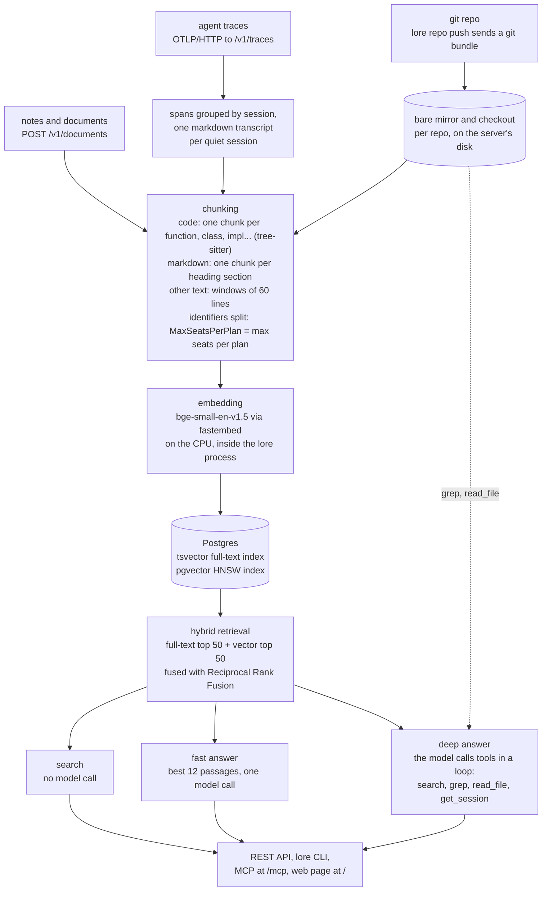

# How lore works

A tour of what happens when you index a repo and when you ask a question. For setup, see the [README](../README.md).

## The flow

lore works out where things are once, when they are indexed, instead of on every question. A question then costs one database query and, for an answer in prose, one model call.

1. **Ingest.** `lore repo push` sends a git bundle of the repo's committed HEAD. After the first push it sends only the commits the server lacks, and only changed files are indexed again. The server keeps a bare mirror and a checkout of each repo. Trace spans arrive over OTLP/HTTP; once a session has had no new span for 60 seconds (`LORE_SESSION_QUIET_SECS`), its spans become one markdown transcript. Notes and documents arrive as text through `POST /v1/documents`.
2. **Chunking.** Rust, Go, TypeScript, TSX, JavaScript and Python files are parsed with tree-sitter into one chunk per top-level item (function, class, struct, impl, trait, interface and so on), together with the comments and attributes directly above it. An item over 150 lines is split: a class, impl, trait or interface into a header and one chunk per member, anything else into windows of 120 lines. Code outside any item goes into chunks of at most 60 lines. Markdown files, session transcripts and documents are split at `#`, `##` and `###` headings. Any other text file becomes windows of 60 lines that overlap by 10. A chunk keeps its line range and its symbol names, such as `Plan` and `Plan::limits`.
3. **Embedding.** Each chunk, with its path (or title) and symbol names in front, is embedded by bge-small-en-v1.5 (384 dimensions) through fastembed, on the CPU, inside the lore process. No embedding API is called. A chunk whose text did not change keeps its stored vector.
4. **Storage.** Each chunk is one Postgres row with a `tsvector` for full-text search and a pgvector embedding (HNSW index, cosine distance). The `tsvector` also holds every identifier split into words, so `MaxSeatsPerPlan` matches a search for "seats". Every row carries its tenant id.
5. **Retrieval.** A query runs against both indexes. Each keeps its best 50 chunks, and Reciprocal Rank Fusion merges the two lists (see [Search](usage.md#search)).
6. **Answers.** Fast mode puts the best 12 passages (at most 60,000 characters) in a prompt as numbered sources and makes one model call. Deep mode gives the model four tools, `search`, `grep`, `read_file` and `get_session`, and runs the calls it asks for on the server, for up to 12 rounds within 30 seconds by default. In both modes lore maps each citation back to its document and line range, and to a link when the source has one.

### What lore does and what the model does

| | lore | The model |
|---|---|---|
| Indexing | Receives bundles, traces and documents; chunks, embeds and stores them | Nothing |
| A search | Runs the full-text and vector searches and fuses the results | Nothing |
| A fast answer | Retrieves the passages, builds the prompt, maps `[n]` citations to files, lines and links | Reads the passages and writes the answer, in one call |
| A deep answer | Runs each tool call against the tenant's index and repo checkouts, enforces the time budget and round limit, maps citations to files, lines and links | Chooses the next tool call and its input, reads the results, writes the answer |
| Access | Tenants, API keys and scopes, per-tenant deep-mode limits; the REST API, CLI, MCP server and web page | Nothing |

### Why it is faster than an agent grepping a checkout

An agent pointed at a checkout finds the relevant code at question time: it greps, reads a file, greps again. Each step is another model round trip, in sequence, and each one sends the whole conversation so far. lore does that discovery once, at index time. A fast question is then tens of milliseconds of retrieval (18 to 36 ms in the measurement below) and one model call. Deep mode still loops, but its `search` starts from ranked chunks rather than raw files, and the tools run on the server next to the index, with the calls of one round run at the same time. [The benchmarks](benchmarks.md) measure the difference on two repos.

## Runs offline?

Partly. Indexing and search never call a model. Answers do, and by default that model is the Anthropic API.

| Capability | Needs a model? | Needs the network? |
|---|---|---|
| Indexing: `lore repo push`, `POST /v1/traces`, `POST /v1/documents` | No | No, only the client's connection to your lore server |
| Search: `lore search`, `GET /v1/search`, the MCP tools `search`, `get_document` and `list_sources` | No | No |
| `fast` answers (`lore ask`, `POST /v1/ask`, the MCP `ask` tool, the web page) with the default `LORE_LLM=anthropic` | Yes, one call | Yes, to the Anthropic API |
| `fast` answers with `LORE_LLM=openai` and a local OpenAI-compatible server, such as llama-server | Yes, one call | No |
| `deep` answers | Yes, a loop of calls with tools | Yes. Deep mode needs a provider that can use tools, which is `anthropic` only: with `openai` a deep question is a 400 |

- The embedder runs on the CPU inside lore. The first start with `LORE_EMBEDDER=fastembed` (the default) downloads the model, about 130 MB, from Hugging Face into `$LORE_DATA_DIR/models` (`$HF_HOME` instead, when that is set), before the server listens. Later starts load it from there without the network. To set up a machine with no network, copy that directory from one that has it.
- With the default provider, `lore serve` does not start without `ANTHROPIC_API_KEY`, even if you only search. It does not call the API at startup, so search keeps working while the network is down. `LORE_LLM=fake` starts without a key, for a server that only searches; its answers are placeholders.
- For answers with no network, run lore with `LORE_LLM=openai`, `LORE_OPENAI_BASE_URL` set to the local server (for example `http://localhost:8081/v1`) and `LORE_OPENAI_MODEL`. That gives fast mode only.

